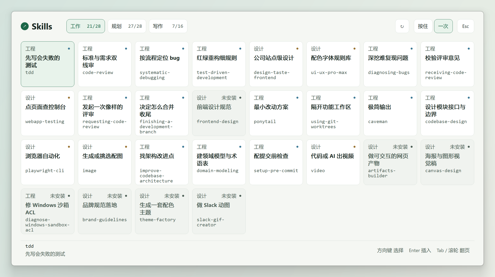

# Skill Peek

[](https://github.com/tingousir/skill-peek/actions/workflows/build.yml)
[](https://github.com/tingousir/skill-peek/releases/latest)
[](LICENSE)


按一个热键，在任何窗口上唤起一块技能面板：**72 个技能分三页，常用的排在左上角，没装的置灰**。方向键选，回车把 `@skill` 粘回你刚才的输入框。



## 下载

**[⬇ 下载最新版 SkillPeek.exe](https://github.com/tingousir/skill-peek/releases/latest/download/SkillPeek.exe)** · 33 KB · Windows 10 / 11

1. 点上面的链接，拿到 `SkillPeek.exe`
2. 双击运行 —— 不用安装、没有依赖、不联网
3. 托盘里会出现图标，按 `Ctrl` + `Shift` + `Space` 唤起

单文件，没有 DLL、没有安装包、没有 webview。唯一的运行时依赖是系统自带的 .NET Framework 4.x。

### 第一次运行会被 SmartScreen 拦

exe 没有代码签名证书，Windows 会弹「已保护你的电脑」。点 **更多信息 → 仍要运行**。

想确认文件没被人动过，可以校验：

```powershell
Get-FileHash .\SkillPeek.exe -Algorithm SHA256
```

结果应该和 Release 里 `SkillPeek.exe.sha256` 的第一段完全一致。

## 用法

| 操作 | 结果 |
|---|---|
| 全局热键 | 唤起 / 收起 |
| 滚轮、`Tab`、`Shift+Tab` | 三页之间切换，也可直接点页签 |
| 方向键、`Home`、`End` | 移动选中项 |
| `Enter` 或单击 | 复制 `@skill`，收起面板，粘贴回原窗口 |
| `Esc` | 收起 |
| 右上角 **↻** | 重新扫描本地已安装的技能 |

右上角可切换 **按住 / 一次**：按住模式下热键一松就收起。托盘菜单里可以开开机自启，或把回车改成「只复制不粘贴」（终端这类 `Ctrl+V` 不是粘贴的地方用）。

## 三页与顺序

| 页 | 内容 | 条数 |
|---|---|---|
| 工作 | 工程 + 设计：调试、审代码、架构、界面、配图 | 28 |
| 规划 | 流程 + 调研 + 增长：怎么开工、查清楚、推出去 | 28 |
| 写作 | 文档、文案、PR、Office、PDF | 16 |

排序不是随机的：`ui/skills.tsv` 里**行的顺序就是显示顺序**，越靠前越常用，也就越靠近左上角。顺序参考的是这些 skill 的源仓库热度（`anthropics/skills`、`obra/superpowers` 等）加日常使用判断，不是真实遥测。

## 自己的技能清单

面板每次唤起都会扫一遍配置目录下的一级子目录，扫到的技能才亮，其余置灰。路径写在配置里：

```ini
; %APPDATA%\SkillPeek\settings.ini
mode=once
hotkey=Ctrl+Shift+Space
paste=1
skills=%USERPROFILE%\.dsh\skills;%USERPROFILE%\.claude\skills
```

要改清单本身（加技能、改顺序、改分类色），编辑 `ui/skills.tsv`，每行五列用 Tab 分隔：

```
工作	tdd	工程	先写会失败的测试	#3E7A96
```

改完重新构建即可。

## 自己构建

```powershell
powershell -ExecutionPolicy Bypass -File .\build.ps1 -Version 0.1.1
```

不需要装 .NET SDK——用 Windows 自带的 `csc.exe` 编译，技能数据作为资源嵌进 exe。产物是 `dist/SkillPeek.exe`（单文件）和 `dist/SkillPeek.exe.sha256`。

## 变更记录

见 [CHANGELOG.md](CHANGELOG.md)。

## 许可

[MIT](LICENSE)
